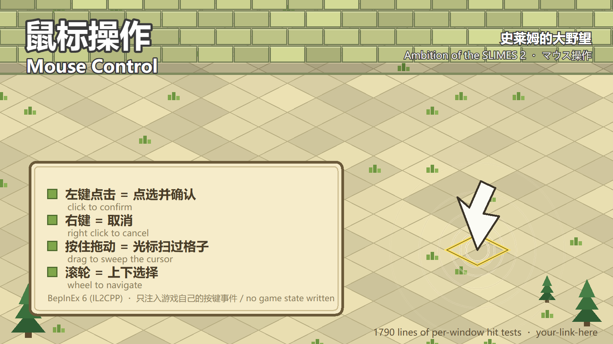

# 史莱姆的大野望 · 插件合集 / Ambition of the SLIMES 2 - Mods / スライム大野望 MOD



> **AI 声明**：本项目的全部代码、说明与宣传图由 AI 助手（DeepSeek）编写；
> 作者负责提出需求、拍板设计取舍、在游戏内实测并负责发布。详见 [AI-DISCLOSURE.md](AI-DISCLOSURE.md)。
>
> **AI disclosure**: all code, documentation and promo art were written by an AI assistant (DeepSeek);
> the author set the requirements, made the design calls, tested everything in the game and owns the release.

给《史莱姆的大野望》（Ambition of the SLIMES 2）写的六个 BepInEx 插件。
Six BepInEx plugins for Ambition of the SLIMES 2. 全六个とも、ゲーム側のファイルには一切触れません。

---

## 中文

### 包含的插件

| 插件 | 做什么 |
|---|---|
| **[史莱姆大修 SlimeFix](mods/SlimeFix)** | 继承次数 999、太阳属性附身改属性、杂鱼掉落本体（每场一次）、溶解史莱姆消化出骷髅、分裂两代（孙代 20% 透明） |
| **[百变史莱姆 MimicSlime](mods/MimicSlime)** | 杂鱼史莱姆可拟态成场上任意单位，等级为对方 70%，保持整场 |
| **[老牌战斗 BattleTweaks](mods/BattleTweaks)** | 造成与受到的伤害翻倍（`Multiplier` 可调） |
| **[道具强化 ItemsTweaks](mods/ItemsTweaks)** | 通关发全部道具、解除道具次数限制、变身道具任意史莱姆可用 |
| **[占领解放 OccupyColorTweaks](mods/OccupyColorTweaks)** | 解除占领限制（保留护盾）、修复强制占领后的显示、可选阵营染色 |
| **[鼠标操作 MouseTweaks](mods/MouseTweaks)** | 给只认键盘的游戏补上鼠标：点选确认、右键取消、拖动扫格、滚轮选择 |

### 安装

1. 给游戏装 **BepInEx 6（IL2CPP，bleeding-edge 版本）**；
2. 到 [Releases](../../releases) 下载你要的插件的 ZIP；
3. 解压出 `.dll`，放进 `<游戏目录>\BepInEx\plugins\`；
4. 启动游戏，配置文件生成在 `BepInEx\config\`。

每个插件都可以单独使用，互不依赖（`SlimeFix` 里那套拟态默认是关的，拟态由单独的 `MimicSlime` 提供）。

### 自己编译

需要 .NET 6 SDK。工程引用的是**你本机游戏目录**里的 BepInEx 程序集，所以先改 `<GameDir>`：

```sh
dotnet build mods/MouseTweaks/MouseTweaks.csproj -c Release
```

---

## English

### What is in here

Six independent BepInEx 6 (IL2CPP) plugins: a slime overhaul (inherit uses, sun possession, body drop,
digest, two-generation splitting), a mimic ability for the zako slime, doubled battle damage, item
rewards and per-slime item budgets, lifted occupation limits with the display fix, and a full mouse
control layer for a game that otherwise only reads the keyboard.

### Install

Install **BepInEx 6 (IL2CPP, bleeding-edge)** for the game, grab the ZIP you want from
[Releases](../../releases), and drop the `.dll` into `<game>\BepInEx\plugins\`.
Config files appear in `BepInEx\config\` after the first launch.

Every plugin stands alone. The mimic feature also exists inside `SlimeFix` but is disabled there by
default; `MimicSlime` is the plugin that provides it.

---

## 日本語

### 収録内容

BepInEx 6（IL2CPP）用の独立した6つのプラグインです：スライム大改修（継承回数・太陽憑依・本体ドロップ・
消化・2世代分裂）、雑魚スライムの擬態、戦闘ダメージ2倍、アイテム強化、憑依制限の解除と表示修正、
キーボード専用ゲームのためのマウス操作層。

### 導入

ゲームに **BepInEx 6（IL2CPP, bleeding-edge）** を入れ、[Releases](../../releases) から欲しい ZIP を
ダウンロードして、`.dll` を `<ゲーム>\BepInEx\plugins\` に入れてください。

各プラグインは単体で動作します。擬態は `SlimeFix` にも入っていますが既定で無効です。

---

## 仓库结构 / Repository layout

本仓库是**六合一（monorepo）**：六个插件的源码各占 `mods/<插件名>/` 一个目录，
下载则挂在 **Releases**，每个插件用自己的 tag（例如 `MouseTweaks-v1.0.0`），
所以每个插件都有独立、固定的下载链接。想拆成六个仓库的话，直接把 `mods/<插件名>/` 单独推出去即可。

## 说明 / Notes

- 本仓库**不包含游戏本体的任何文件**（贴图、音频、数据表都没有），只包含插件源码与说明；
- 三个插件的简介都准备了**中英日三语**，放在各自的 `mods/<插件>/description.md`；
- 构建产物（DLL）不放在仓库里，而是挂在 **Releases** 页面，方便直接下载。
